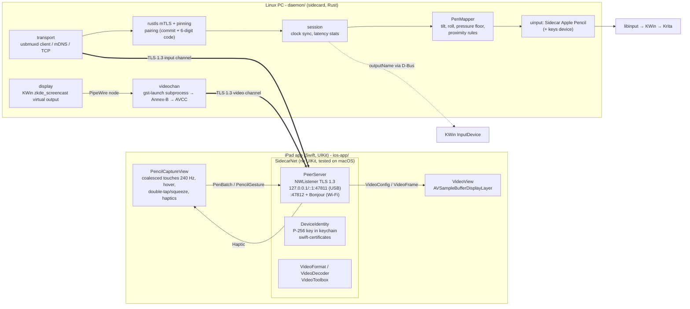
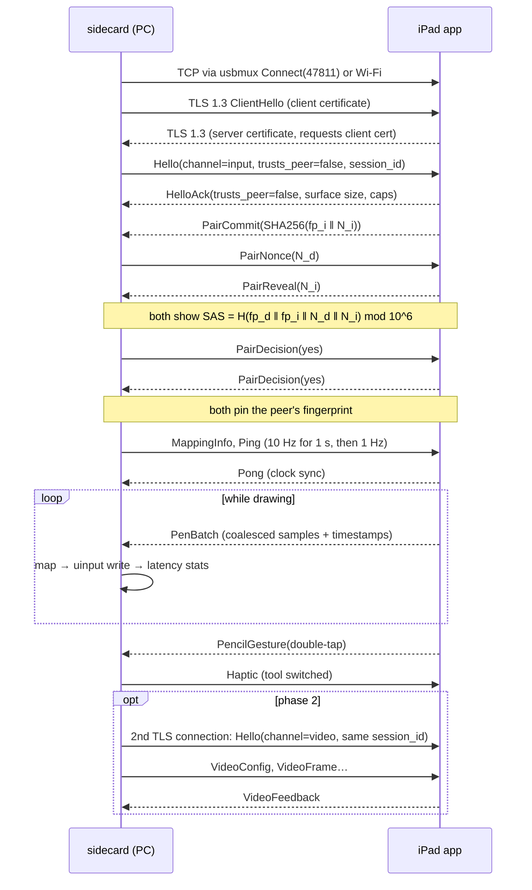

# Architecture

## Components

Over USB, `usbmuxd` on the PC tunnels the TCP connection to the iPad's loopback listener, so no IP networking over USB is involved. Over Wi-Fi the daemon finds the iPad with mDNS (`_sidecarlinux._tcp`).

## Session sequence (first pairing)

## Where to look

| Concern | Code | Tests |
|---|---|---|
| Wire format | `protocol/rust/src/messages.rs`, `protocol/swift/Sources/SidecarProtocol/Messages.swift` | `protocol/rust/tests/vectors.rs`, `protocol/swift/Tests` (golden `protocol/vectors/vectors.json`) |
| Pairing math | `protocol/*/pairing*` | both of the above |
| Pen → evdev | `daemon/src/tablet.rs`, `gestures.rs` | `daemon/tests/mapper.rs`, `daemon/tests/uinput.rs`, `scripts/ci-uinput-check.sh` |
| Session, TLS, clock | `daemon/src/session.rs`, `tls.rs`, `clock.rs` | `daemon/tests/end_to_end.rs` |
| USB transport | `daemon/src/usbmux.rs`, `transport.rs` | `daemon/tests/usbmux.rs` (fake usbmuxd) |
| iPad networking | `ios-app/Sources/SidecarNet/PeerServer.swift`, `Identity.swift` | `ios-app/Tests/SidecarNetTests` (incl. the real Rust daemon) |
| iPad pencil capture | `ios-app/Sources/SidecarPad/PencilCaptureView.swift` | on-device only (MORNING.md §7) |
| Video | `daemon/src/video.rs`, `videochan.rs`, `display.rs`; `SidecarNet/VideoDecoder.swift`, `SidecarPad/VideoView.swift` | `video_vectors.rs`, `end_to_end.rs` (video), `VideoDecoderTests.swift`, interop test |
